# Hi, I'm Utkarsh

Second-year student at SRMIST Kattankulathur. I build machine-learning and security projects
and test them on **real public data**. Every number on this page comes from a held-out
evaluation and is documented, with its data source, in the project's README. That includes
the projects where the honest answer was "no signal".

  

## Selected work

| Project | Verified result | Stack | Links |
| --- | --- | --- | --- |
| **Alibi** · threat intelligence | Dashboard and API on 18 public security feeds. Its network-risk model, tested on later weeks it never saw, scores ROC-AUC 0.964; the riskiest 1% of address space holds 69% of new attack servers (95% CI 61–78%), against 68% for a simple rule. | FastAPI · scikit-learn · DuckDB · globe.gl | [repo](https://github.com/UtkarshOver9000/alibi) · [demo](https://impossible-travel-auth-anomaly-engi.vercel.app) |
| **Phishing URL detection** | Catches 63.2% of phishing domains live on the OpenPhish feed, with 9 false alarms per 10,000 real sites. Includes an audit of this dataset's ~100% URL-format shortcut. | scikit-learn · FastAPI | [repo](https://github.com/UtkarshOver9000/phishvpn-detection) · [demo](https://phishvpn-detection-ochre.vercel.app) |
| **Scam Site Detector** | Rule-based browser extension measured on 235,795 real pages: few false alarms, low recall. The numbers are why the phishing model exists. | TypeScript · Chrome extension API | [repo](https://github.com/UtkarshOver9000/scam-site-detector) |
| **AETHERGRID Ω** · SIH 2026 | On 84 real Uttar Pradesh households (CEEW smart meters), cuts day-ahead feeder scheduling error by 11.7% against the best naive method. | LightGBM · PuLP · Gymnasium · Streamlit | [repo](https://github.com/UtkarshOver9000/aethergrid-omega) |
| **AETHERGRID World Sim** · SIH 2026 | 24-society electricity district in the browser, with a reality check against real household meter data. | Python · Three.js | [repo](https://github.com/UtkarshOver9000/aethergrid-worldsim) · [3D demo](https://aethergrid-worldsim.vercel.app) |
| **RAHA** · Team Antimatter | Replays five real transit disruptions (Chennai, New Delhi, Mumbai, Singapore, Madrid). Over 200 seeds, priority-based recovery cuts the 95th-percentile wait at Tambaram from 49 to 32 minutes and lifts deadlines met from 85% to 99%. | JavaScript · Three.js · OpenStreetMap | [repo](https://github.com/UtkarshOver9000/RAHA-sim) · [demo](https://raha-phi.vercel.app) |
| **HoldWorld** · Bolna Buildathon | Simulated Indian helplines for testing a hold-for-me phone agent. The call-centre queue model, fitted on 440,837 real calls, reproduces 12 unseen days: wait correlation 0.99, abandonment 16.8% simulated vs 16.7% real. | Python · Three.js | [repo](https://github.com/UtkarshOver9000/holdworld) · [demo](https://holdworld-five.vercel.app) |
| **AI Research Copilot** | Citation-first document Q&A. BM25 on BEIR SciFact reaches nDCG@10 0.663 on held-out claims, in line with the published BEIR BM25 baseline (0.665), which checks the implementation. | FastAPI · Next.js | [repo](https://github.com/UtkarshOver9000/ai-research-copilot) · [demo](https://ai-research-copilot-delta.vercel.app) |
| **Stock Price Movement Predictor** | 12 US stocks, 104,565 trading days: no model beats a constant guess with statistical significance (every p > 0.17). The repo documents why. | scikit-learn · pandas | [repo](https://github.com/UtkarshOver9000/Stock-price-predictor) · [dashboard](https://gcsrmstockpricepredictor-seven.vercel.app) |
| **Crypto Surge Prediction** | 9 years of Binance data, 100 coins: indicators don't predict 7-day +15% surges (ROC-AUC 0.53) and lose to random picks after fees. Modest volatility signal (0.60). | scikit-learn · FastAPI | [repo](https://github.com/UtkarshOver9000/crypto-surge-prediction) |
| **F.A.S.T** | Website for the Futuristic AI Society of Tech, an NVIDIA Student Developer Ecosystem community at SRMIST Kattankulathur. | React · Vite · Tailwind | [repo](https://github.com/UtkarshOver9000/F.A.S.T-website) · [site](https://f-a-s-t-website-one.vercel.app) |

**Tools I use:** Python · TypeScript · JavaScript · scikit-learn · LightGBM · pandas · NumPy ·
FastAPI · DuckDB · React · Next.js · Three.js · Docker · GitHub Actions

## Contribution graph

  

## Quote of the day

<!-- quote:start -->
> The first principle is that you must not fool yourself, and you are the easiest person to fool.
>
> — Richard Feynman
<!-- quote:end -->

---

The profile scan and contribution graph are rebuilt daily from live GitHub data by <a href="scripts/cards.py">scripts/cards.py</a>, which also picks the day's quote.
